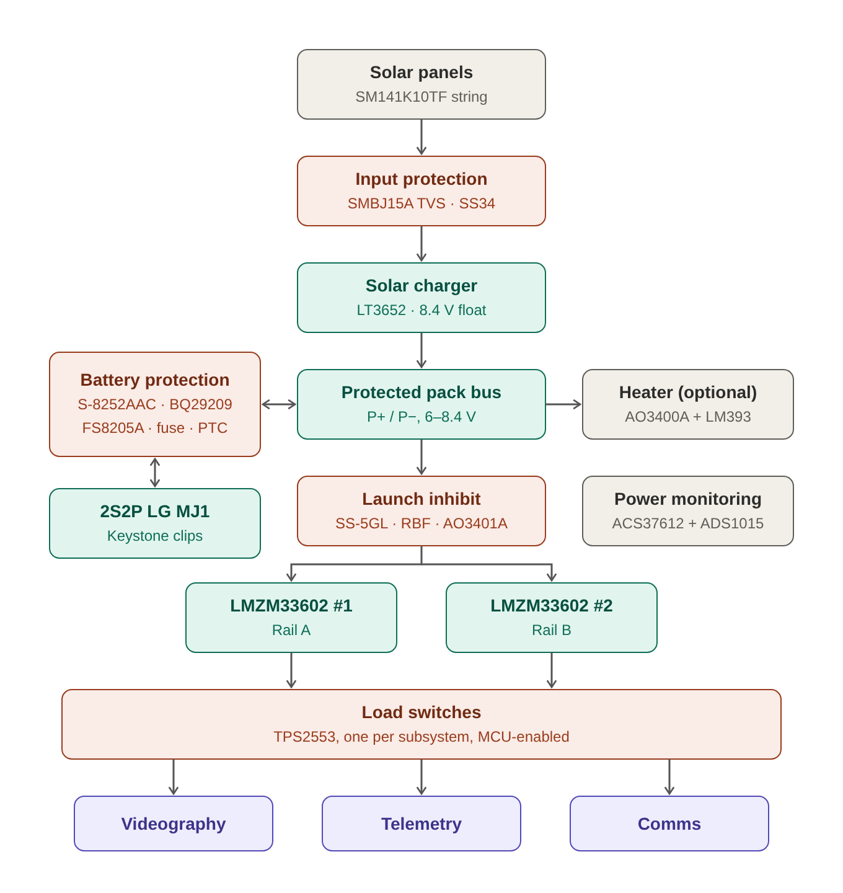

# 01 — Design spec: LOBOSAT EPS 2S2P

## What the board does

Solar panels charge a 2S2P Li-ion pack through an LT3652 charger. The pack powers two
LMZM33602 regulators (Rail A, Rail B). Current-limited TPS2553 switches feed three
subsystems: **Videography, Telemetry, Comms**. Protection is layered:

1. **S-8252AAC** (primary): per-cell overcharge, over-discharge, discharge overcurrent,
   short circuit, charge overcurrent. Drives the FS8205A cutoff FETs.
2. **BQ29209** (backup): independent per-cell overvoltage → stops the charger. Also balances
   the two cell pairs.
3. **Fuse + PTC** (last resort): Littelfuse 0466 hard fuse + 0ZCJ0100FF2E PTC in the pack
   positive path.

## Blocks → schematic sheets

| Sheet file | Block | Main parts |
|---|---|---|
| `solar_input.kicad_sch` | Solar input + surge/backfeed protection | Solar connector, SMBJ15A, SS34 |
| `charger.kicad_sch` | LT3652 charger | LT3652EMSE#PBF, inductor, STPS140ZY, CMSH3-40MA, WSL2512R0500FEA, dividers, NTC |
| `battery.kicad_sch` | 2S2P pack on clips + protection + current monitor | 4× Keystone 18650 clips, S-8252AAC, BQ29209, FS8205A, 0466, 0ZCJ, INA228 + shunt, NTC |
| `launch_inhibit.kicad_sch` | Deployment / RBF switch | SS-5GL, AO3401A |
| `regulation.kicad_sch` | Two rails | 2× LMZM33602RLRR |
| `load_switches.kicad_sch` | Per-subsystem switches + output connectors | 3× TPS2553, 3× output connectors |
| `telemetry.kicad_sch` | Power monitoring + MCU interface | ADS1015, dividers, pull-ups, I²C/GPIO connector |

**Single flat sheet (Julien's preference, 2026-10-23):** all blocks are on `EPS_Lobosat_V1.kicad_sch`, one dashed box per block. The table above lists blocks, not files. (Kit text, superseded: root sheet holds only the hierarchical sheet symbols and the
connections between them.

## Electrical summary

| Item | Value | Notes |
|---|---|---|
| Pack | 2S2P LG MJ1 18650 | 6.0–8.4 V, mid-point tap required |
| Charge float | 8.4 V | Float divider 154 kΩ / 100 kΩ (already decided) |
| Charge current limit | Set by 50 mΩ sense resistor | WSL2512R0500FEA |
| Charger input regulation (VIN_REG) | **TBD** | Old divider 143k/100k is for 1S and is WRONG for 2S |
| Rail A / Rail B voltage | **3.3 V / 5 V** | Decided 2026-10-23. FB/RT/CFF from LMZM33602 Table 7-1 |
| Overcharge cutoff (S-8252AAC) | 4.30 V/cell | Factory-set by part suffix |
| Over-discharge cutoff | 2.40 V/cell | Factory-set |
| Backup OVP (BQ29209) | 4.30 V/cell | BQ29209 (NOT BQ29200 = 4.35 V) |
| Load switch input | Must be ≤ 6.5 V | TPS2553 goes AFTER the regulators, never on the pack bus |

## Decisions you must respect

- DW01A is **removed** (1S only). Do not add it back.
- FS8205A is **kept** as the cutoff FET pair, in the **pack negative** path.
- Cells mount in **Keystone 18650 clips** on the EPS board. No battery connector.
- The ground of everything downstream of the protection is **P−** (net `GND`). The cell
  negative before the FETs is a separate net `BAT_N`. Do not merge them.
- Heater block: **dropped** (decided 2026-10-24).
- Launch inhibit count depends on the launch provider. Build **one** inhibit (one SS-5GL
  + AO3401A) and leave a note.

## Decisions made 2026-10-23 (supersede the kit where they differ)

- **Telemetry = INA228 + ADS1015.** INA228 with a 10 mΩ shunt in the pack positive path
  (between main fuse and PTC) measures battery current, bus voltage and charge. ADS1015 reads
  VSOLAR, VBUS, BAT_MID and the NTC. The ACS37612 is dropped (net `I_BAT` no longer exists).
- **Rail A = 3.3 V, Rail B = 5 V.** `VLOGIC` and `VSENSE` are simply `RAIL_A`.
- BQ29209 OUT gets its own global net `CHG_OVP`; MCU request is `CHG_SHDN`. Each drives its own
  N-FET pulling LT3652 SHDN low.

## Net naming convention

- Power nets: UPPERCASE with underscores (`VBUS`, `BAT_MID`, `RAIL_A`).
- Active-low signals end in `_N` **only if** they are logic signals (`CHG_EN_N`).
  `BAT_N` is the pack negative (historic name, keep it).
- One flat sheet → every net is a **local label**; same text = same net.
  Nets inside one sheet → **local labels** or wires.
- `GND` uses the KiCad `power:GND` symbol everywhere. All other power nets use global labels
  so their names show up exactly as written in the netlist.
