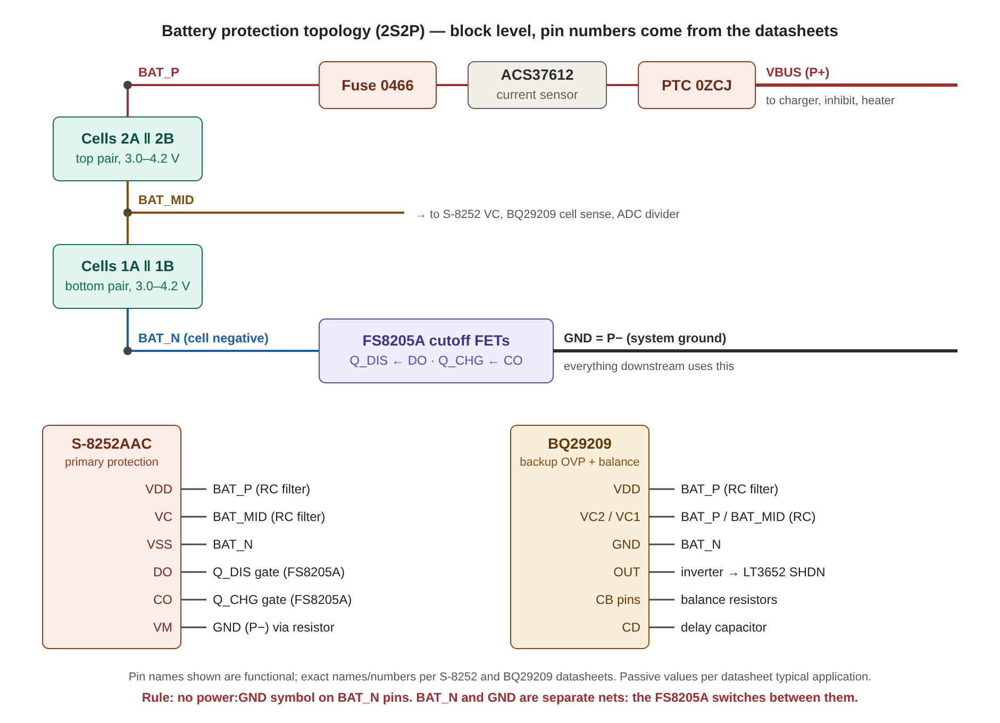

# 02 — Connections (source of truth for nets)

> Implemented in `scripts/gen_schematic.py` (`build_sheets()`), which is now the exact,
> pin-level version of this file. If the two disagree, the script is what's in the schematic.

How to use this file:

- Each sheet lists its **parts** and the **nets** each part connects to, by *pin function*.
- **Pin numbers are NOT given here on purpose.** Look up the pin number for each function in the
  part's symbol and confirm it in `datasheets/`. If a function can't be found, report it.
- Support passives (decoupling caps, RC filters, delay caps, pull-ups) follow the **typical
  application circuit in the datasheet**. Use the datasheet's values. Where the datasheet gives
  a range or a choice, pick the typical value and list it in your phase summary.
- Lines marked **[DS]** mean "follow the datasheet reference circuit exactly".
- Lines marked **[TBD]** mean place the part, set Value = `TBD`, and list it in the summary.

## Nets shared between blocks

| Net | Meaning | Sheets |
|---|---|---|
| `VSOLAR` | Solar after TVS + blocking diode → charger input | solar_input, charger |
| `BAT_P` | Pack positive, cell side (before fuse) | battery, charger* |
| `BAT_MID` | Mid-point between the two parallel pairs | battery, telemetry |
| `BAT_N` | Pack negative, cell side (before cutoff FETs) | battery only |
| `VBUS` | Protected pack positive (after fuse + PTC) | battery, charger, heater, launch_inhibit, telemetry |
| `VBUS_SW` | Pack positive after launch inhibit | launch_inhibit, regulation, telemetry |
| `RAIL_A`, `RAIL_B` | Regulator outputs | regulation, load_switches |
| `PWR_VID`, `PWR_TLM`, `PWR_COM` | Switched subsystem outputs | load_switches |
| `EN_VID`, `EN_TLM`, `EN_COM` | Load switch enables from MCU | load_switches, telemetry |
| `FLT_VID_N`, `FLT_TLM_N`, `FLT_COM_N` | Load switch fault outputs (open-drain) | load_switches, telemetry |
| `CHG_SHDN` | Charger shutdown request from the MCU (high = stop) | charger, telemetry |
| `CHG_STAT_N`, `CHG_FAULT_N` | LT3652 CHRG / FAULT status (open-drain) | charger, telemetry |
| `INA_ALERT_N` | INA228 ALERT (open-drain) | battery, telemetry |
| `CHG_OVP` | BQ29209 OUT, high = cell overvoltage | battery, charger |
| `RAIL_A` as logic / sensor supply | 3.3 V. Replaces the kit's `VSENSE` / `VLOGIC` (decided 2026-10-23) | battery, telemetry, load_switches, heater |
| `NTC_BAT` | Battery temperature NTC divider node for the ADC | battery, telemetry |
| `I2C_SDA`, `I2C_SCL` | I²C to the MCU / OBC | telemetry |
| `HEATER_EN` | MCU heater command | heater, telemetry |
| `GND` | System ground = **P−** (after cutoff FETs) | all |

*`BAT_P`: the LT3652 charges the pack through the protection, so the charger output goes to
`VBUS`, not `BAT_P`. `BAT_P` should only appear in the battery sheet. Remove it from the
charger sheet if you find no use for it.

---

## Sheet: solar_input

| Part | Connections |
|---|---|
| Solar input connector (2-pin, from panel string) | Pin + → `VSOLAR_RAW` (local), Pin − → `GND` |
| SMBJ15A TVS | Cathode → `VSOLAR_RAW`, Anode → `GND` |
| SS34 Schottky (backfeed block) | Anode → `VSOLAR_RAW`, Cathode → `VSOLAR` |

## Sheet: charger (LT3652EMSE#PBF) — follow the datasheet typical application [DS]

| Function | Connects to |
|---|---|
| VIN | `VSOLAR` (+ input bulk/ceramic caps per [DS]) |
| VIN_REG | Divider from `VSOLAR` to `GND`. Resistor values **[TBD]** |
| SHDN | `CHG_SHDN` logic. See note below |
| SW | Inductor (~4.7 µH, ≥3 A) to the sense resistor node; catch diode CMSH3-40MA from SW to GND per [DS] |
| BOOST | 0.1 µF boost cap SW↔BOOST, STPS140ZY boost diode per [DS] |
| SENSE / BAT | 50 mΩ WSL2512R0500FEA between SENSE and BAT; BAT side = `VBUS` |
| VFB | Float divider 154 kΩ (top) / 100 kΩ (bottom), from `VBUS` |
| NTC | NCP18XH103F03RB to GND, physically on the cells (note in Value/Description) |
| CHRG | `CHG_STAT_N` (open-drain) |
| FAULT | `CHG_FAULT_N` (open-drain) |
| TIMER | Per [DS] (timer cap or tie as datasheet says for C/10 termination) |
| GND + exposed pad | `GND` |

**SHDN note:** the LT3652 SHDN is active-low with a threshold (check [DS]). The BQ29209 OUT goes
**high** on overvoltage. Insert a small N-FET or NPN inverter so that BQ29209 OUT high pulls
SHDN low. Do not wire OUT directly to SHDN. If you're unsure of the polarity after reading both
datasheets, put it in `MISSING_PARTS.md` → "Design questions" and leave a no-connect.

## Sheet: battery — see topology image

| Part | Connections |
|---|---|
| 18650 clips (Keystone), cell 1A and 1B **in parallel** | + → `BAT_MID`, − → `BAT_N` (bottom pair) |
| 18650 clips, cell 2A and 2B **in parallel** | + → `BAT_P`, − → `BAT_MID` (top pair) |
| Optional per-cell fuse 0466 (×4) | In series with each cell's + terminal. Mark **DNP** by default |
| Littelfuse 0466 (main fuse) | `BAT_P` → `BAT_P_F` (local) |
| INA228AIDGSR + 10 mΩ 2512 shunt | Shunt in series `BAT_P_F` → `BAT_P_S` (local), so it sees charge AND discharge current. IN+ = `BAT_P_F`, IN− = `BAT_P_S`, VBUS pin = `VBUS`, VS = `RAIL_A` + 0.1 µF, GND = `GND`, A0 = A1 = GND (0x40), SDA/SCL → `I2C_SDA`/`I2C_SCL`, ALERT → `INA_ALERT_N`. (Was ACS37612; changed 2026-10-23) |
| 0ZCJ0100FF2E PTC | `BAT_P_S` → `VBUS` |
| S-8252AAC-M6T1U | VDD → top of pack via RC filter [DS]; VC → `BAT_MID` via RC filter [DS]; VSS → `BAT_N`; DO → FET gate (discharge FET); CO → FET gate (charge FET); VM → `GND` (P−) through resistor [DS] |
| FS8205A (dual N-FET, common drain) | Discharge FET source → `BAT_N`; charge FET source → `GND` (P−); drains tied together (internal on FS8205A); gates from DO and CO |
| BQ29209DRBR | VDD from top of pack via RC filter [DS]; VC2/VC1 cell sense inputs → `BAT_P`, `BAT_MID` via RC filters [DS]; GND → `BAT_N`; OUT → `CHG_SHDN` path (see charger note); CB_EN → enabled per [DS]; balance pins with balance resistors per [DS]; CD delay cap per [DS] |
| NTC (NCP18XH103F03RB) for telemetry | Divider with fixed 10 kΩ from a reference rail to `GND`, node = `NTC_BAT`. Reference rail: the ADS1015 supply (see telemetry) |

**Ground reference warning:** S-8252 and BQ29209 are referenced to `BAT_N`. Everything else is
referenced to `GND` (P−). Only the FS8205A connects the two. Do not put a `power:GND` symbol on a
`BAT_N` pin.

## Sheet: launch_inhibit

| Part | Connections |
|---|---|
| AO3401A (P-FET) | Source → `VBUS`, Drain → `VBUS_SW`, Gate → `INH_GATE` (local) |
| Gate pull-up resistor (100 kΩ) | `INH_GATE` → `VBUS` (FET off by default) |
| SS-5GL switch (deployment / RBF) | Closes `INH_GATE` → `GND` when deployed (FET on). Use the switch's NO/NC contacts so that **RBF inserted / stowed = FET off**. Check SS-5GL pin naming [DS] |
| Gate–source protection | Optional Zener per AO3401A Vgs limit (±12 V); pack max is 8.4 V so note it but don't add unless asked |

## Sheet: regulation (2× LMZM33602RLRR) [DS]

| Function | Connects to |
|---|---|
| VIN (both) | `VBUS_SW` with input caps per [DS] |
| VOUT #1 / #2 | `RAIL_A` / `RAIL_B` with output caps per [DS] |
| FB | Feedback divider **[TBD]** values (rail voltages not decided) |
| EN | Per [DS] (tie to VIN via divider or to an enable label `EN_RAIL_A/B`) |
| PGOOD | `PG_RAIL_A` / `PG_RAIL_B` labels to telemetry (optional, pull-up per [DS]) |
| GND + exposed pad | `GND` |

## Sheet: load_switches (3× TPS2553) [DS]

| Instance | IN | OUT | EN | FAULT | ILIM |
|---|---|---|---|---|---|
| U_VID | `RAIL_A` (default, may change) | `PWR_VID` | `EN_VID` | `FLT_VID_N` | ILIM resistor **[TBD]** |
| U_TLM | `RAIL_A` (default, may change) | `PWR_TLM` | `EN_TLM` | `FLT_TLM_N` | **[TBD]** |
| U_COM | `RAIL_B` (default, may change) | `PWR_COM` | `EN_COM` | `FLT_COM_N` | **[TBD]** |

Each output gets an output cap per [DS] and an output connector (2-pin: PWR_x, GND). Check the
TPS2553 EN polarity variant (TPS2553 vs TPS2553-1) in [DS] and note which one the library part is.

## Sheet: telemetry

| Part | Connections |
|---|---|
| ADS1015IRUGR | AIN0 = `VSOLAR` via divider; AIN1 = `VBUS` via divider; AIN2 = `BAT_MID` via divider; AIN3 = `NTC_BAT`; ADDR = GND (0x48); SDA/SCL → `I2C_SDA`/`I2C_SCL`; ALERT/RDY → `ADC_ALERT_N`. Each AIN must stay ≤ VDD (3.3 V) |
| Voltage dividers | Scale `VBUS` (≤8.4 V) and `BAT_MID` (≤4.2 V) below the ADC full-scale you choose. Use 0.1 % resistors if available, else 1 %. Values: choose and justify in summary |
| MCU interface connector | `I2C_SDA`, `I2C_SCL`, `EN_VID`, `EN_TLM`, `EN_COM`, `FLT_*_N`, `CHG_STAT_N`, `CHG_FAULT_N`, `ADC_ALERT_N`, `HEATER_EN`, `CHG_SHDN` (MCU side), sensor supply, `GND`. Pin order is up to you; document it |
| Pull-ups | 10 k to `RAIL_A` on `FLT_*_N`, `CHG_*_N`, `ADC_ALERT_N`, `INA_ALERT_N`, `PG_RAIL_A/B`; 4.7 k on I²C |

## Sheet: heater — DROPPED 2026-10-24 (kept for reference, not in the schematic)

| Part | Connections |
|---|---|
| Heater resistors (2512) or heater pad connector | `VBUS` → `HTR_SW` (local) |
| AO3400A (N-FET) | Drain → `HTR_SW`, Source → `GND`, Gate → `HTR_GATE` |
| LM393 | Comparator 1: NTC divider vs "too cold" threshold → turns heater on. Comparator 2: NTC divider vs "too hot" threshold → forces heater off. Output combines with `HEATER_EN` (MCU) via resistor-OR/diode logic. Thresholds **[TBD]** |
| NTC (NCP18XH103F03RB) | Divider with 10 kΩ, on the cells |
| Gate pull-down | 100 kΩ `HTR_GATE` → `GND` |
